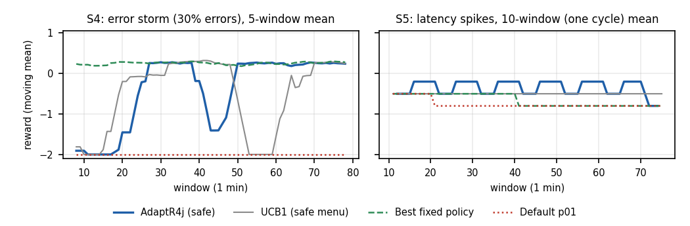

# AdaptR4j — safe online adaptation of Resilience4j policies

[](https://arxiv.org/abs/2611.32015)
[](LICENSE)

AdaptR4j changes **Resilience4j** CircuitBreaker / Retry / Bulkhead settings **at runtime** in a
Spring Boot 3 service and lets a **bandit** pick among complete policies from live Prometheus
metrics. This repository contains the code, the experiment harness, **all raw experiment data**,
and the scripts that produce every number in the accompanying paper.

> **Paper (preprint):** R. M. Barot and A. S. Borkhatariya, *When Online Adaptation of Resilience
> Policies Hurts: Safe Exploration and Measurement Pitfalls in Resilience4j*,
> [arXiv:2611.32015](https://arxiv.org/abs/2611.32015), 2026.

## Key findings

1. **Naive online adaptation can be worse than doing nothing.** A LinUCB bandit over a 30-policy
   menu lost to the production-default policy in three of four winnable fault scenarios, because
   exploration kept applying circuit breakers that rejected almost all traffic.
2. **Two simple safeguards fix it.** A *safe policy menu* (no breaker stricter than the latency SLO)
   plus *safe exploration* with a bounded reward beat the default in every winnable scenario
   (p < 0.001, 3 runs each, SD ≤ 0.03) and beat the **best fixed policy** when the fault changes
   over time.
3. **The safeguards matter more than the learner.** A context-free UCB1 bandit on the same safe menu
   is statistically indistinguishable from AdaptR4j.
4. **Measurement can invert conclusions.** Our first harness reported p99 ≈ 140 ms and 0.1 % errors
   while **94.5 % of user requests failed**. See [How measurement fooled us](#how-measurement-fooled-us).

| Scenario | AdaptR4j (safe), 3 runs | Default p01 | Best fixed policy | UCB1, safe menu | Naive design |
|---|---|---|---|---|---|
| S1 moderate (50 ms, 4 %) | **+0.257 ± 0.002** | −2.000 | +0.518 | +0.050 | +0.441 |
| S2 severe (200 ms, 10 %) | **−1.821 ± 0.021** | −2.000 | −1.438 | −1.823 | −1.862 |
| S3 pure latency (500 ms) | −2.000 | −2.000 | −2.000 | – | −2.000 |
| S4 error storm (30 %) | **−0.315 ± 0.010** | −2.000 | +0.249 | −0.526 | −0.848 |
| S5 latency spikes (0↔500 ms) | **−0.451 ± 0.026** | −0.842 | −0.763 | −0.603 | −0.764 |

Mean reward per one-minute window (higher is better; −2 = latency SLO missed in every window).
S3 cannot be won by any policy. Full table with user-visible failure rates in the paper.



## How measurement fooled us

| Harness | Scenario | p99 the controller saw | errors it saw | users who failed |
|---|---|---|---|---|
| original | S1 | 138 ms | 0.10 % | **94.5 %** |
| original | S2 | 106 ms | 0.06 % | **97.4 %** |
| fixed | S1 | 280 ms | 0.12 % | 0.1 % |

Two bugs combined:

1. **Unit mismatch.** The policy menu expresses circuit-breaker thresholds as fractions (`0.50`);
   Resilience4j expects percent (`50`). Every breaker ran with a 0.2–0.8 % threshold and opened on
   the first error. (Fixed in `PolicyReferenceHolder.asPercent`.)
2. **Invisible rejections.** Latency and errors were measured inside the resilience chain, so calls
   rejected by an open breaker were never counted as errors and their ~0 ms durations pulled p99
   down. Now latency is measured at the edge and every exception the caller sees counts as an error
   (`DownstreamClient`, `adaptr4j_downstream_rejected_total{reason}`).

Smaller defects: non-standard decorator order (bulkhead held through retry back-off), retries of
the library's own rejections, a Locust `LoadTestShape` that silently overrode `--users`, and a
rollback that counted shadow-mode windows.

**Checks we recommend:** measure at the outermost layer the user sees; cross-check controller
metrics against the load generator every run; read back the live configuration
(`/actuator/circuitbreakers`) after each change; treat results that look too good as a bug.

## Repository layout

| Path | Contents |
|---|---|
| `service-a/` | Edge service: `PolicyReferenceHolder` (atomic policy swap), `DownstreamClient`, `POST /policy` |
| `service-b/`, `service-c/` | Fault-injectable downstream services (`POST /api/fault?latencyMs=&errorRate=`) |
| `main.py`, `bandit.py`, `guardrails.py`, `metrics_client.py` | Policy engine (LinUCB, `--safe-explore`, guardrails, Prometheus queries) |
| `baseline_runner.py` | Baselines: `static-p01`, `static:<id>`, `sweep`, `random`, `ucb1`, `rule` |
| `policy-menu.yml`, `policy-menu-safe.yml` | Full 30-policy menu and the 14-policy safe menu |
| `locust/workloads.py` | Load profiles (W2 = 50 users, 0.5–2 s think time) |
| `scripts/run_v2_queue.ps1` | Runs every experiment (`-variant v2` naive, `-variant v3` safe design); resumable |
| `scripts/watchdog_v2.ps1` | Optional health checks and backups during long runs |
| `logs/v2/`, `logs/v3/` | **Raw data**: per-window decision logs (`decisions-*.jsonl`) and Locust results |
| `analysis/` | Scripts that produce every number and figure in the paper |
| `paper/` | Paper sources |

## Reproducing the numbers from the published data

```bash
python -m venv .venv && .venv/Scripts/pip install -r requirements.txt   # Windows; use .venv/bin on Linux/macOS
python analysis/v3_final.py      # main results table, block-bootstrap p-values
python analysis/v3_extra.py      # convergence, latency, user-visible failure rates
python analysis/sweep_table.py   # per-policy outcomes per scenario (safe-menu rule)
python analysis/fig_v3.py        # figure
```

## Re-running the experiments

Requirements: Java 21 + Maven, Python 3.12, Prometheus 2.52 (on `PATH` or `PROMETHEUS_EXE`),
optionally Toxiproxy (`TOXIPROXY_EXE`). Scripts are PowerShell (Windows); each job starts fresh
services, so allow about 85 minutes per 80-window run.

```powershell
mvn -q package -DskipTests                       # builds service-a/b/c
python -m venv .venv; .venv\Scripts\pip install -r requirements.txt
powershell -ExecutionPolicy Bypass -File scripts\run_v2_queue.ps1 -variant v3   # safe design
powershell -ExecutionPolicy Bypass -File scripts\watchdog_v2.ps1 -dir v3        # optional, 2nd window
```

Notes from our own runs: keep the machine on AC power and prevent sleep/updates; on an 8 GB laptop,
close browsers (the services and Locust need about 2 GB of free memory).

## Limitations

Single machine, synthetic faults, one workload; baselines run once. The safe-menu rule was derived
from the same sweeps it is evaluated on. See the paper's "Open issues" section.

## Citation

If you use AdaptR4j, its data, or the measurement checklist, please cite:

```bibtex
@misc{barot2026adaptr4j,
  title         = {When Online Adaptation of Resilience Policies Hurts: Safe Exploration
                   and Measurement Pitfalls in Resilience4j},
  author        = {Barot, Rajat M. and Borkhatariya, Arjun S.},
  year          = {2026},
  eprint        = {2611.32015},
  archivePrefix = {arXiv},
  doi           = {10.48550/arXiv.2611.32015},
  url           = {https://arxiv.org/abs/2611.32015}
}
```

## License

MIT — see [LICENSE](LICENSE).
